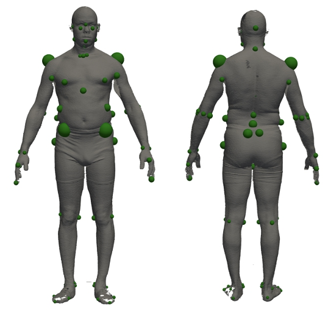
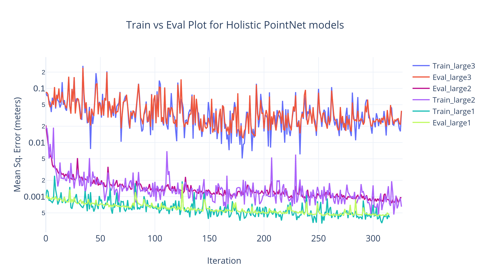

# 3D-Landmark-Localization

**Geometric Deep Learning for Automated Anthropometric Landmark Localization on 3D Human Body Scans and 2D Ergonomic Blueprint Extraction**

[](#citation)
[](https://www.python.org/)
[](https://www.tensorflow.org/)
[](LICENSE)

> **Reference implementation** of the paper:
> *"Machine Learning to Define Anthropometric Landmarks for Relevant Product Design 2D Blueprint Measures"*
> **Ahmed Baruwa, Susan L. Sokolowski, Jacob Searcy, and Daniel Lowd** — *Interdisciplinary Practice in Industrial Design*, Vol. 100, AHFE 2023. [Read the paper →](https://openaccess.cms-conferences.org/publications/book/978-1-958651-76-6/article/978-1-958651-76-6_0)

---

## Overview & Research Motivation

Functional product designers (apparel, footwear, protective equipment) rely on anthropometric measures taken between surface landmarks to draft 2D product blueprints. Most 3D body-scan databases ship without these landmarks, so they're normally added by hand — slow, costly, and inconsistent between annotators.

**Core Research Question:**
*Can a deep neural network reliably localize anatomical landmarks directly from raw, unorganized 3D body-scan point clouds, accurately enough to replace manual landmarking?*

This repository implements the pipeline developed to answer that question:
1. **Preprocessing:** Matching each CAESAR point cloud to its landmark annotations and normalizing coordinate scale to meters.
2. **3D Landmark Localization:** Training a compact 1D-convolutional network per landmark to regress 3D (x, y, z) coordinates directly from the raw point cloud.
3. **(Exploratory) 2D Measurement Extraction:** Deriving linear, geodesic, and circumference measurements between predicted landmarks — included in the codebase, but not part of the paper's published evaluation (it's described there as future work).

<p align="center">
  
  <br>
  <em>Model-predicted landmark locations (green) on an example CAESAR scan. Sphere size is proportional to prediction error.</em>
</p>

---

## Methodology

### 1. Data Preprocessing & Representation
* **Dataset:** CAESAR (2002) — ~9,000 3D body scans (7K train / 2K validation), ~200K vertices per scan, across standing and seated postures.
* **Normalization:** point cloud coordinates are rescaled to meters (CAESAR scans mix metric/imperial units) and padded to a uniform `(200000, 3)` tensor, with a `Masking` layer telling the network which points are padding.
* **Landmarks:** of the 100 annotated landmarks, the 74 with ≥10 labeled samples were kept and grouped into 5 body categories — Head, Torso, Digits, Crotch, Limbs — with one model trained per landmark.

### 2. Model Architecture & Loss Formulation
* **Backbone:** a compact 1D-CNN ([`models/cnn_classifier.py`](models/cnn_classifier.py)) — three masked `Conv1D` layers (128 filters, 1×1, LeakyReLU) → `GlobalMaxPooling1D` → FC(512, LeakyReLU) → FC(3). Kept deliberately small relative to heavier point-cloud networks (e.g. PointNet, VoxNet) to stay memory-efficient on ~200K-point scans.
* **Training Objective:** mean squared error (MSE) between predicted and ground-truth landmark coordinates, optimized with Adam (`lr=1e-3`) for 100 epochs (~2 hours on an NVIDIA Tesla V100), implemented in TensorFlow.

### 3. Beyond the Paper
The repo also contains exploratory, unpublished variants — a PyTorch PointNet model ([`models/pointNet/`](models/pointNet/)) and a DGL graph neural network ([`models/gnn/`](models/gnn/)) — plus a `Tape` utility ([`src/landmark/measure.py`](src/landmark/measure.py)) for deriving 2D-style measurements from predicted landmarks.

---

## Key Results & Diagnostic Analysis

### Quantitative Performance
Evaluated on the 2,000-scan validation split using average **Mean Squared Error (MSE)** per body category:

| Body Category | Torso | Limbs | Digits | Head | Crotch |
| :--- | :---: | :---: | :---: | :---: | :---: |
| Average MSE (cm) | 0.91 | 1.48 | 1.77 | 1.83 | 2.28 |

MSE stayed under 1.83 cm for every category except **Crotch**, whose landmarks are known in the anthropometry field to be difficult to localize consistently even by hand. The single largest per-landmark errors were on the left/right **Acromion** and **Iliocristale** — also notoriously hard for human annotators to palpate.

<p align="center">
  
  <br>
  <em>Train/eval MSE over training iterations for the exploratory PointNet models (models/pointNet/).</em>
</p>

---

## Quickstart

```bash
conda create --name env_landmark --clone anaconda-tensorflow2-gpu-20210607-nvidiatest
conda activate env_landmark
pip install matplotlib plyfile scipy
```

1. `python data/lmcreateDS.py <caesar_directory>` → builds per-scan `(point cloud, landmarks)` pickles.
2. `python scripts/train_classifier.py` → trains a model for one landmark (50 epochs) and saves weights.

## Citation

```bibtex
@article{baruwa2023landmarks,
  title     = {Machine Learning to Define Anthropometric Landmarks for Relevant Product Design 2D Blueprint Measures},
  author    = {Baruwa, Ahmed and Sokolowski, Susan L. and Searcy, Jacob and Lowd, Daniel},
  journal   = {Interdisciplinary Practice in Industrial Design},
  volume    = {100},
  pages     = {1--6},
  year      = {2023},
  doi       = {10.54941/ahfe1002965}
}
```

## License

MIT — see [LICENSE](LICENSE).
